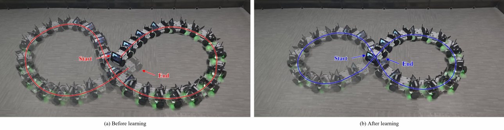
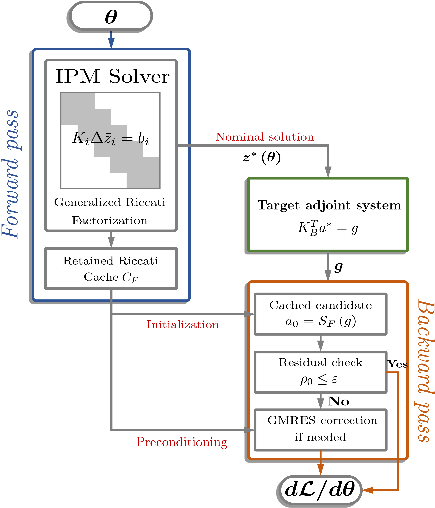
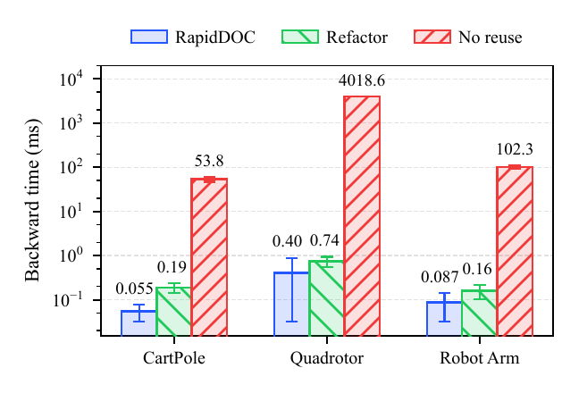
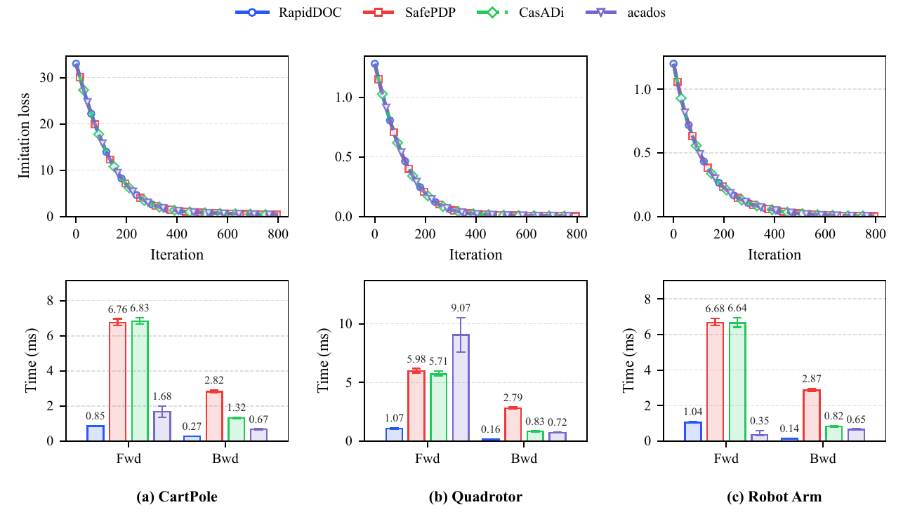
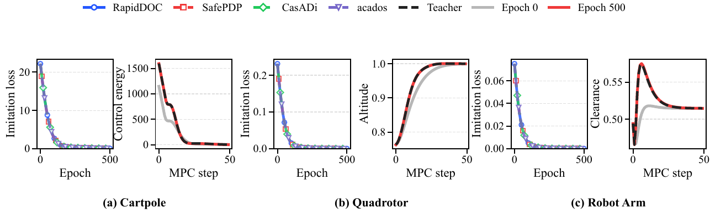
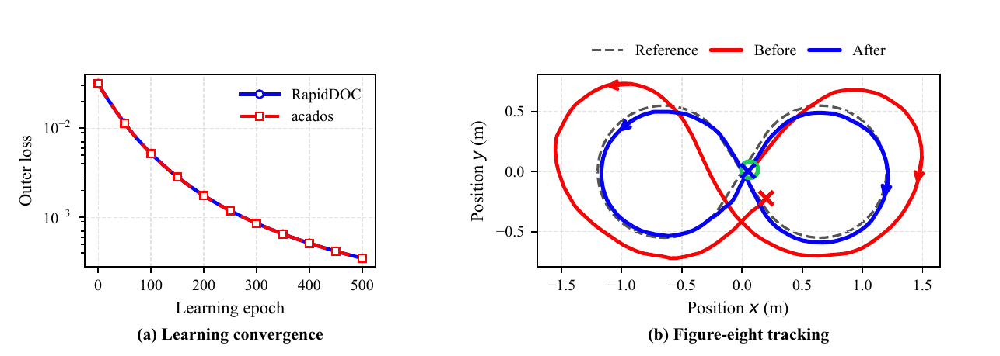

# RapidDOC

**Riccati-Preconditioned Implicit Differentiation for Differentiable Optimal Control under Operator Mismatch**

Xiangda Zhu, Yuankun Chen, Zifei Nie*, and Yi Chang*  
*Corresponding authors. Contact: [zifei_nie@jlu.edu.cn](mailto:zifei_nie@jlu.edu.cn).

[Video](https://youtu.be/b53gcrjdS7c) · [Installation](docs/INSTALL.md) · [Tutorials](tutorials/README.md) · [Experiments](docs/REPRODUCIBILITY.md)

RapidDOC accelerates implicit differentiation through optimal-control solutions by reusing the forward solver's Riccati factorization. It checks the cached adjoint against the target equation and, when necessary, corrects it with right-preconditioned GMRES using the same factors.

This repository includes the C++ implementation, Python binding, FATROP integration patch, runnable examples, paper experiments, recorded data, and vehicle controller sources. The Python distribution is named `rapiddoc`; the retained Python import is `rapidoc`.

## Demonstration

[](https://youtu.be/b53gcrjdS7c)

[Watch on YouTube](https://youtu.be/b53gcrjdS7c) · [Download the demonstration video](assets/RapidDOC_demo.mp4)  
Cover: the paper's physical vehicle experiment figure.

## Project Summary

The notation and equations below follow the accompanying manuscript. The prescribed target adjoint is

$$
K_B^\top a^\star=g.
$$

The forward Riccati cache supplies the fixed solve action

$$
\mathcal S_F(v)
:=
\operatorname{CachedSolve}(\mathcal C_F,v).
$$

For a nonzero loss seed $g$, the cached candidate and its target-residual test are

$$
a_0:=\mathcal S_F(g).
$$

$$
r_0:=g-K_B^\top a_0,
\qquad
\rho_0:=\frac{\|r_0\|_2}{\|g\|_2}.
$$

If $\rho_0>\varepsilon$, GMRES solves the right-preconditioned correction equation

$$
K_B^\top\mathcal S_F(y)=r_0,
\qquad
a=a_0+\mathcal S_F(y).
$$

The parameter gradient is then obtained from the target adjoint using

$$
\frac{\mathrm d\mathcal L}{\mathrm d\theta}
=
\nabla_\theta\mathcal L-G_B^\top a^\star.
$$

The target operator $K_B$ and cached solve action $\mathcal S_F$ remain fixed during the backward solve. Every returned candidate is checked against the prescribed target equation. The manuscript PDF and LaTeX sources are not included in this code repository.

The implementation provides:

- A C interface for borrowing a forward cached-solve callback or importing saved factors.
- Native factor applications and residual-controlled GMRES correction.
- A lightweight Python `ctypes` binding and frozen-case examples.
- Open- and closed-loop OCP imitation-learning experiments.
- Native vehicle training, ROS1 controller sources, and recorded physical runs.



*Fig. 1. Original manuscript framework; rasterized for display.*

## File Structure

```text
rapidoc/                         C++ implementation, C header and Python binding
  patches/                       FATROP cache-export patch
experiments/
  exp1_factor_reuse_ablation/     Frozen OCP cases and backward-solve comparisons
  exp2_ocp_imitation/             Open- and closed-loop imitation learning
  exp3_vehicle/                  Vehicle training, ROS1 deployment and recordings
tutorials/                       Minimal examples and a suggested learning path
examples/                        Offline frozen-data inspection
tests/                           Offline data-integrity and operator checks
tools/                           Artifact verifier and environment diagnostics
docs/                            Installation, API, reproduction and upload guides
assets/                          Original paper figures and demonstration video
```

## Installation

### Python interface and data inspection

Use Python 3.10 or newer. From this repository:

```bash
python -m pip install -e .
python -c "import rapidoc; print(rapidoc.__version__)"
python examples/inspect_frozen_case.py
```

To install plotting and experiment dependencies:

```bash
python -m pip install -e ".[experiments]"
```

Python installation exposes the binding; the native solver is built separately. Data inspection and offline tests work without that native build.

### Native solver

Requirements: CMake >=3.21, a C++17 compiler, OpenMP, BLASFEO, and a matching FATROP 1.1.7 source/install pair. The included patch targets commit `5951e14989175108e0a64c0f726af8fbe19563f3`.

After preparing the patched FATROP dependencies, build with:

```bash
cmake -S . -B build/core -DCMAKE_BUILD_TYPE=Release -DFRS_FATROP_SOURCE_DIR=/path/to/patched/fatrop -DCMAKE_PREFIX_PATH="/path/to/fatrop/install;/path/to/blasfeo/install"
cmake --build build/core --config Release --parallel
```

See [Installation](docs/INSTALL.md) for the exact patch commands, Windows setup, runtime library paths, and imitation-learning backend. The core library is written to `build/bin/`; `FRS_SOLVER_DLL` overrides its location.

## Usage Examples

The [tutorials](tutorials/README.md) start with a saved OCP case so that the first example needs no model-generation or training pipeline.

Inspect a frozen case without building native libraries:

```bash
python examples/inspect_frozen_case.py
```

After the native build, reuse the recorded factors to solve and independently check one target adjoint:

```bash
python tutorials/frozen_adjoint.py --problem cartpole --seed 0
```

The example reports the target residual, number of correction iterations, and cached factor applications. It uses the same experiment helper as the ablation. For integrating a live forward solver, see the [C API and cache-lifetime guide](docs/API.md).

## Experiment Reproduction

Each experiment retains its inputs, settings, recorded outputs and plotting code. New runs should use a separate output directory. The historical method label `Ours` denotes RapidDOC.

### Paper-to-code map

| Paper item | Entry point | Recorded output |
|---|---|---|
| Fig. 1: method overview | Method summary above | [Original framework figure](assets/figures/fig1_framework.png) |
| Fig. 2: factor-reuse ablation | [experiment.py](experiments/exp1_factor_reuse_ablation/experiment.py), [plot.py](experiments/exp1_factor_reuse_ablation/plot.py) | [Summary CSV](experiments/exp1_factor_reuse_ablation/results/gmres_real_ocp_ablation_summary.csv) |
| Fig. 3: open-loop learning | [imitation_learning.py](experiments/exp2_ocp_imitation/imitation_learning.py), `run` / `plot` | [Learning curves](experiments/exp2_ocp_imitation/figures/fig3_open_loop_imitation_learning.pdf) |
| Fig. 4 and Table I: closed-loop learning | Same script, `closed-loop` / `plot-closed-loop` | [Closed-loop curves](experiments/exp2_ocp_imitation/figures/fig4_closed_loop_imitation_learning.pdf), [records](experiments/exp2_ocp_imitation/results/closed_loop) |
| Fig. 5: vehicle learning | [Training sources](experiments/exp3_vehicle/training), [plot_learning.py](experiments/exp3_vehicle/plot_learning.py) | [Selection and RMSE metadata](experiments/exp3_vehicle/results/figure8_learning_metadata.json) |
| Fig. 6 and Table II: physical vehicle runs | [ROS1 controller](experiments/exp3_vehicle/ros), [experiment guide](experiments/exp3_vehicle/README.md) | [Recorded runs](experiments/exp3_vehicle/data), [video](https://youtu.be/b53gcrjdS7c) |

### Experiment 1: Factor Reuse

Three OCP tasks are supplied: cartpole, quadrotor and robot arm, with 32 frozen cases per task. The comparison uses RapidDOC, exact-target refactorization, and unpreconditioned GMRES at the same requested target-residual tolerance.

```bash
python experiments/exp1_factor_reuse_ablation/experiment.py --problems cartpole --instances 1 --repeats 1 --output-dir runs/ablation-smoke
python experiments/exp1_factor_reuse_ablation/plot.py
```

The solve requires the native core and CasADi/MUMPS for the independent reference. Plotting uses the recorded CSV files.



### Experiment 2: OCP Imitation Learning

Prepare the native imitation backend, then check installed backends and run a small learning example:

```bash
python experiments/exp2_ocp_imitation/imitation_learning.py check-backends --methods Ours
python experiments/exp2_ocp_imitation/imitation_learning.py run --methods Ours --quick --output-dir runs/open-loop-smoke
python experiments/exp2_ocp_imitation/imitation_learning.py closed-loop --methods Ours --quick --output-dir runs/closed-loop-smoke
```

`--quick` is a smoke configuration. Full paper settings and the instrumented Safe-PDP, IPOPT and acados baselines are described in the [experiment guide](experiments/exp2_ocp_imitation/EXPERIMENT.md).





### Experiment 3: Vehicle Learning and Deployment

```bash
python experiments/exp3_vehicle/plot_learning.py
```

This redraws the recorded learning histories. Native training and ROS1 deployment target Linux; follow the [vehicle guide](experiments/exp3_vehicle/README.md) for builds, model identity, topics and controller settings. The final demonstration video is included. Rebuilding camera-frame composites requires the original raw recording, which is not bundled.



All six displayed figures come from the manuscript's final figure PDFs. Only the file format was converted for web display; layouts, curves and annotations were not redrawn. Source figure hashes and conversion details are in [figure provenance](assets/figures/provenance.json).

## Solver Parameters

The standalone example exposes the following settings. These do not change the saved target matrices or forward factors.

| Option | Meaning | Example default |
|---|---|---|
| `--problem` | Frozen task: `cartpole`, `quadrotor`, `robotarm` | `cartpole` |
| `--seed` | Saved case index, from 0 to 31 | `0` |
| `--tolerance` | Required relative target-KKT residual | `1e-6` |
| `--max-iterations` | Maximum GMRES correction steps; omitted uses the KKT dimension | KKT dimension |

The ablation also accepts `--methods`, `--instances`, `--repeats`, `--cases-dir` and `--output-dir`; run its `--help` for all choices. Native statistics distinguish factor applications, GMRES orthogonalization, residual checks and workspace preparation; see [API notes](docs/API.md).

## Tests

```bash
python tools/verify_artifact.py
python -m unittest discover -s tests -v
python tools/check_environment.py
```

Offline tests check 96 frozen inputs, immutable artifact hashes, the target-operator symmetry identity, lazy binding imports, and publication assets. [Validation](VALIDATION.md) records the checks actually run, including the native build and nine smoke solves. Complete training and physical experiments are separate reproduction tasks.

## Citation

```bibtex
@misc{zhu2026rapiddoc,
  title  = {RapidDOC: Riccati-Preconditioned Implicit Differentiation for
            Differentiable Optimal Control under Operator Mismatch},
  author = {Zhu, Xiangda and Chen, Yuankun and Nie, Zifei and Chang, Yi},
  year   = {2026},
  note   = {Manuscript}
}
```

Machine-readable citation metadata is available in [CITATION.cff](CITATION.cff). Publication identifiers can be added when available.

## Dependencies and Contributing

See [THIRD_PARTY.md](THIRD_PARTY.md) for dependency provenance and [CONTRIBUTING.md](CONTRIBUTING.md) for changes and checks. A project-wide code license has not yet been selected. The supplied third-party notices retain their original scope.
